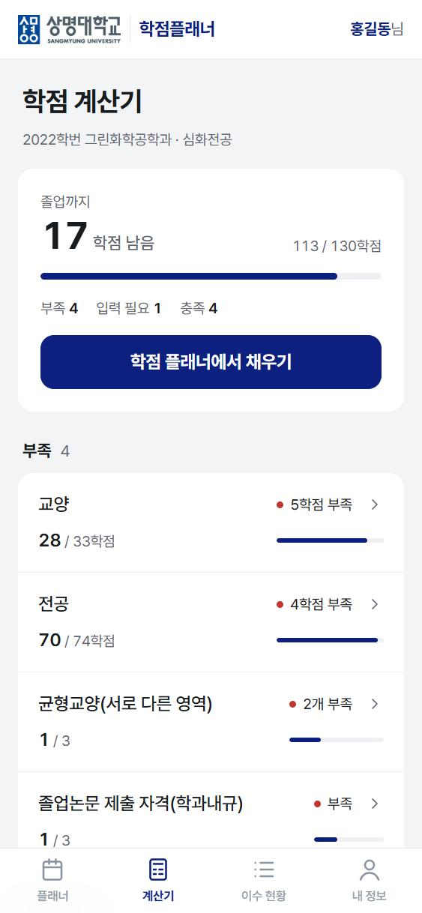
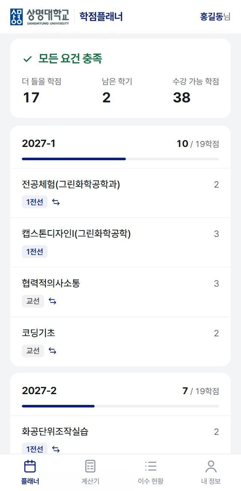
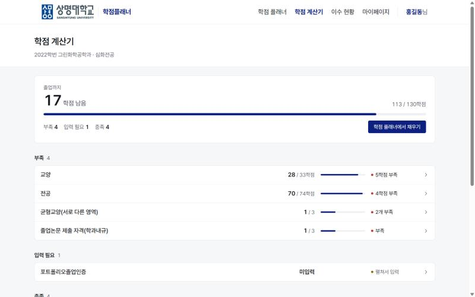
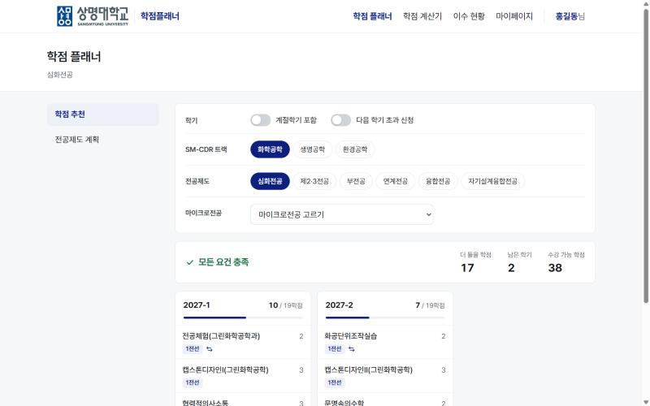
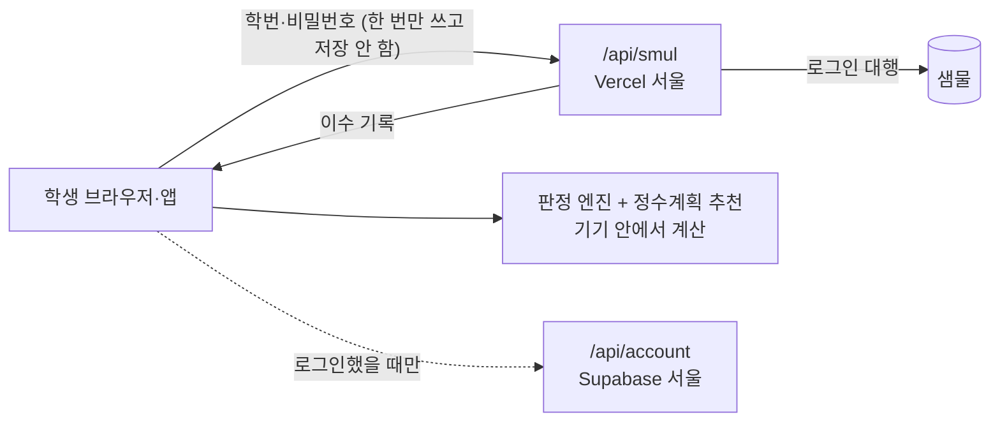

<div align="center">


# 학점플래너

**졸업까지, 편하게, 생각대로.**

샘물 기록을 한 번 불러오면 졸업요건을 영역별로 판정하고,<br>
남은 학기에 무엇을 들어야 졸업하는지 계획까지 짜 줍니다.

상명대학교 천안캠퍼스 · 2022~2026학번

[](https://github.com/mungn0603-code/grad-planner-smu/actions/workflows/ci.yml)
[](https://github.com/mungn0603-code/grad-planner-smu/releases/latest)


[**바로 써 보기**](https://grad-planner-dusky.vercel.app) · [Android 앱 받기](https://github.com/mungn0603-code/grad-planner-smu/releases/latest) · [설계 결정 기록](docs/decisions/README.md) · [작업명세서](docs/SPEC.md)


&nbsp;&nbsp;


</div>

## 왜 만들었나

졸업요건은 학번·학과·전공제도마다 다릅니다. 학생은 교육과정표와 성적표를 나란히 놓고 한 과목씩 맞춰 봐야 하고, 계산이 한 번 틀리면 빠진 요건을 졸업 직전에야 알게 됩니다. 상명프렌즈가 천안캠퍼스 학생 15명을 대면 상담했을 때도 이 문제가 나왔습니다.

학점플래너는 이 계산을 대신해 **졸업까지 남은 것을 놓치지 않게** 하는 것을 첫 번째 목표로 합니다.

## 체험하기

샘물 계정이 없어도 아래 테스트 아이디로 모든 화면을 볼 수 있습니다. 실제 학생이 아닌, 이름을 바꾼 시연용 기록입니다.

| 아이디 | 비밀번호 | 학생 |
|---|---|---|
| `1001` | `1234` | 2022학번 그린화학공학과 신입학, 마이크로전공 3개 |
| `1002` | `1234` | 2026학번 그린화학공학과 일반편입 |

[바로 써 보기](https://grad-planner-dusky.vercel.app) → **시작하기** → 동의 → 아이디·비밀번호 입력

**앱으로 쓰기**
- iPhone: 사파리에서 열고 공유 → **홈 화면에 추가**
- Android: Chrome 메뉴 → **홈 화면에 추가**, 또는 [Releases](https://github.com/mungn0603-code/grad-planner-smu/releases/latest)에서 APK를 받아 설치

## 기능

| | |
|---|---|
| **학점 계산기** | 샘물 기록으로 교양·전공·균형교양·학과 내규까지 영역별 충족 여부를 판정합니다. 부족한 영역은 몇 학점이 모자란지 바로 보입니다 |
| **학점 플래너** | 남은 학기마다 들을 과목을 추천합니다. 계절학기·초과 신청·SM-CDR 트랙·전공제도를 바꾸면 바로 다시 계산합니다 |
| **전공제도 계획** | 심화전공·제2·3전공·부전공·연계·융합·자기설계융합·마이크로전공을 미리 넣어 보고 비교합니다 |
| **이수 현황** | 지금까지 들은 과목과 영역을 한 표로 봅니다 |
| **어디서나 이어서** | 구글·카카오로 로그인하면 다른 기기에서도 이어서 봅니다(선택) |

편입생·유학생·휴학생·학번별 기준처럼 학생마다 다른 조건을 그대로 반영합니다.

<details>
<summary>PC 화면 보기</summary>




</details>

## 어떻게 동작하나



- **성적은 기기 안에서 계산합니다.** 판정과 추천은 브라우저(Web Worker) 안에서 돌고, 성적을 서버로 보내 계산하지 않습니다([ADR 0009](docs/decisions/0009-data-minimization.md)).
- **추천은 정수계획(HiGHS)으로 풉니다.** 요건을 모두 채우는 계획을 최적으로 찾고, 시간이 넘으면 탐욕 방식으로 대신합니다([ADR 0003](docs/decisions/0003-ilp-recommendation.md)).
- **엔진은 하나, 학교는 데이터로.** 학교마다 코드를 따로 만들지 않고 요건을 데이터로 적습니다([ADR 0001](docs/decisions/0001-one-engine-many-data.md)).
- **앱은 같은 웹을 감쌉니다.** 홈 화면 설치(PWA)와 Capacitor Android 앱이 같은 운영 주소를 엽니다([ADR 0030](docs/decisions/0030-pwa-app-wrap.md)).

### 얼마나 맞는지 어떻게 확인했나

| 확인 | 결과 |
|---|---|
| 첫 앱과 판정 비교 (40개 학과, 3,700개 사례) | 설명 안 된 불일치 0 ([ADR 0004](docs/decisions/0004-oracle-verification.md)) |
| 추천 품질 (3,700개 사례) | 하드 제약 위반 0, 최적 증명 3,700/3,700 ([ADR 0003](docs/decisions/0003-ilp-recommendation.md)) |
| 추천 속도 | p50 28ms · p95 94ms (첫 저장소 측정) |
| 샘물 기록과 대조 | 이수 기록은 샘물 값을 정답으로 봅니다 ([ADR 0016](docs/decisions/0016-smul-source-of-truth.md)) |

모든 PR에서 타입 검사·빌드·엔진 테스트·오라클 해시 검사를 돌리고, 앱 파일이 바뀌면 Android·iOS 빌드도 돌립니다.

## 기술 스택


왜 이 조합인지는 [ADR 0021](docs/decisions/0021-stack-review.md)에 대안과 함께 적었습니다.

## 개발

필요한 것: Node.js 24 이상 (TypeScript를 Node에서 바로 실행합니다)

```bash
git clone https://github.com/mungn0603-code/grad-planner-smu.git
cd grad-planner-smu
npm ci
npm run oracle      # 첫 앱으로 오라클 정답을 만든다(V1 테스트가 씀, git에는 넣지 않음)
npm run typecheck   # 타입 검사
npm test            # 엔진 테스트
npm run dev         # 개발 서버(http://localhost:5173), /api/smul·/api/account도 함께 붙는다
npm run build       # 배포용 빌드(dist/)
```

오라클은 상명프렌즈 첫 앱(V44)이 낸 판정 결과입니다. 새 엔진이 같은 사례에서 같은 결과를 내는지 비교해 이식이 맞는지 확인합니다.

<details>
<summary>환경 변수</summary>

서버 함수(`api/`, 나눈 모듈은 `server/`)에서만 씁니다. 값은 Vercel 환경 변수(배포)나 `.env`(개발)에 넣고 저장소에는 올리지 않습니다.

| 이름 | 필수 | 뜻 |
|---|---|---|
| `SUPABASE_URL` | 예 | Supabase 프로젝트 URL |
| `SUPABASE_SERVICE_ROLE_KEY` | 예 | Supabase 비밀 키(service role). 서버 함수에서만 씁니다 |
| `SMUL_KEY_SECRET` | 예 | 학번·IP를 HMAC으로 가리는 임의의 긴 문자열 |
| `SMUL_TEST` | 아니요 | 테스트 아이디(시연·심사용). `{"<4자리 아이디>": {"pw", "id"(표시 학번), "rows", "student", …}}` 꼴로, 샘물 가져오기 응답에서 이름을 바꾸고 이수 현황만 담습니다. 개발 서버는 `private/test-accounts.json`을 읽습니다 |
| `VITE_REPORT_URL` | 아니요 | 졸업요건 오류 신고를 받을 주소. 없으면 신고 문구를 클립보드에 복사합니다 |

GitHub Actions 비밀값 `ANDROID_KEYSTORE`·`ANDROID_KEYSTORE_PASSWORD`는 Android 앱 서명용입니다([ADR 0030](docs/decisions/0030-pwa-app-wrap.md)).

</details>

<details>
<summary>배포와 앱 빌드</summary>

- **웹**: Vercel 프로젝트 `grad-planner`. `main`에 병합하면 운영 배포(https://grad-planner-dusky.vercel.app), PR마다 미리보기 배포가 생깁니다. 환경 변수는 운영 배포에만 들어 있습니다.
- **앱**: GitHub Actions `App` 워크플로가 Android APK와 iOS 시뮬레이터 빌드를 만듭니다. 앱은 운영 주소를 열기 때문에 화면을 고쳐도 앱을 다시 빌드할 필요가 없습니다.

</details>

## 문서

| 문서 | 내용 |
|---|---|
| [작업명세서](docs/SPEC.md) | 무엇을, 왜, 어떤 순서로 만드는지. 전공제도 명세, 기능 범위, 개발 규칙, 이식 계획, 테스트 기준 |
| [설계 결정 기록](docs/decisions/README.md) | 결정마다 근거와 검토한 대안 (ADR) |
| [구현 기록](docs/ARCHITECTURE.md) | 첫 버전의 설계·검증 기록 |
| [핸드오프](docs/handoff/2026-11-16-account-flow.md) | 최근 상태와 다음 작업의 시작점 |

<details>
<summary>이식 진행 (P0~P9 완료)</summary>

첫 버전(claude.ai 아티팩트)을 이 저장소로 파트별로 옮겼습니다.

| 파트 | 내용 | 상태 |
|---|---|---|
| P0 | 명세서·작업 규칙·결정 기록·기술 스택 결정 | 완료 |
| P1 | 개발 환경·CI | 완료 |
| P2 | 졸업요건 판정 엔진·천안캠퍼스 데이터·오라클 | 완료 |
| P3 | 범위 정리(천안캠퍼스 한정) | 완료 |
| P4 | 수강 계획 추천 | 완료 |
| P5 | 전공제도 재정의 | 완료 |
| P5b | 연계·융합전공 데이터 | 완료 |
| P5c | 교육과정 빈칸 정리 | 완료 |
| P6 | 샘물 가져오기 | 완료 |
| P7 | 화면 | 완료 |
| 배포 | 첫 운영 반영 v1.0.0 | 완료 |
| P8 | 회원제(구글·카카오 로그인) | 완료 |
| P9 | 홈 화면 설치·앱 포장 | 완료 |

</details>

## AI 활용 기록

Claude Code로 개발합니다. 쓴 도구와 잘된 사례·사람이 고친 사례는 이식을 마치며 이 절에 정리합니다([작업명세서](docs/SPEC.md) '해야 할 일').
